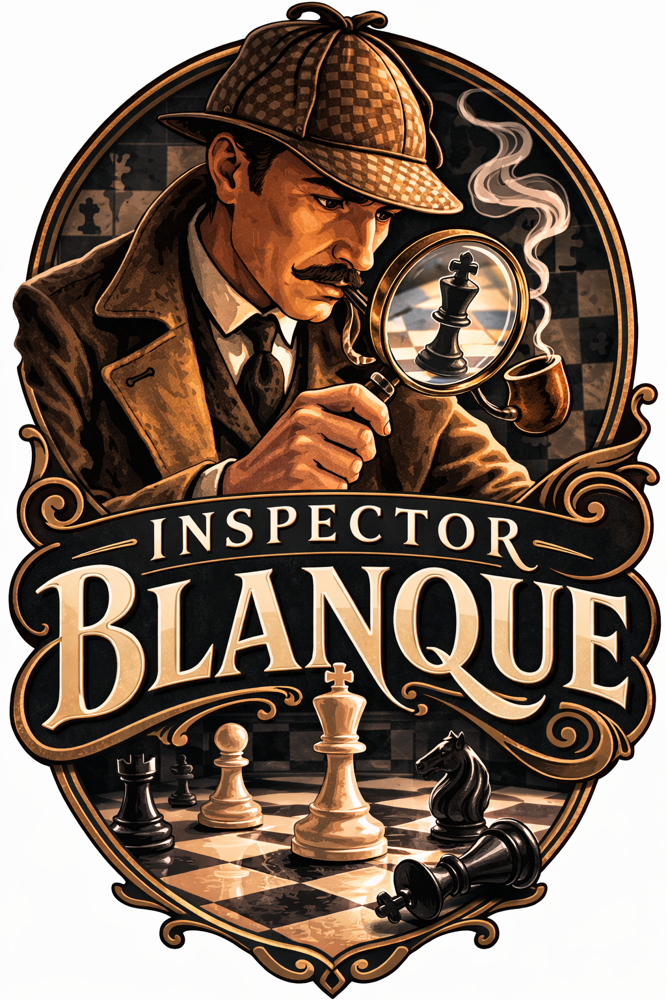

# Inspector Blanque



A mobile-first chess position and game analyzer. It evaluates positions and grades every move of a PGN with a local Stockfish WebAssembly engine, entirely on your device and offline. It ships as a web app and as an Android app built from the same code.

## Get it

| Where | What |
|-------|------|
| **[jwkunz.github.io/Inspector_Blanque](https://jwkunz.github.io/Inspector_Blanque/)** | The web app, always the latest `main` (deployed by GitHub Pages) |
| **[Releases](https://github.com/jwkunz/Inspector_Blanque/releases)** | `inspector-blanque-vX.Y.Z.html`, a single self-contained file you can save and open locally, and `inspector-blanque-vX.Y.Z-debug.apk`, the Android app |

## Features

- Upload or paste PGN/FEN input
- Load PGN/FEN input into Game View before choosing an analysis action
- Local, offline Stockfish WASM evaluation in browser
- VS Code-style dark interface with mobile-friendly layout
- Game View panel with a navigable chessboard and board-flip control
- Higher-quality local SVG chess piece sprites in Game View
- On-demand best-move reveal in Game View with green arrow overlay and SAN text
- Light-perspective centipawn gauge with mirrored Light/Dark score text
- Needle and score display stay in sync with the currently viewed board position
- PGN time control and clock annotations shown in Game View when available
- Game View shows cumulative captured material for each side and the viewed position's textual evaluation
- Average centipawn loss (Avg CPL) for Light and Dark, with quality percent shown as `100 - loss%`
- Total CPL for Light and Dark over the full game
- PGN player names and ratings shown in the Dark and Light summary cards when available
- Move-category totals per side shown in table format with emoji markers (`Best`, `Excellent`, `Good`, `Inaccuracy`, `Mistake`, `Blunder`)
- MultiPV-backed move grading using best-move gap comparisons
- Fast, Standard, and Deep analysis profiles, with an optional borderline-category recheck pass
- Cooperative match-analysis cancellation: completes the current position, then stops and shows partial results
- Borderline-move depth rechecks with in-run evaluation caching for more stable labels
- Phase-aware category thresholds (opening, middlegame, endgame)
- Mate-aware category overrides for forced-mate transitions
- Win-probability swing as primary move-grade signal with CPL tie-breaks
- Confidence-aware label softening using MultiPV spread, volatility, and recheck stability
- Estimated skill band per side derived from ACPL heuristics
- Mate handling (`Mate in N`) with gauge pinning
- No best move is shown by default; principal variation lines and broader recommendation output remain hidden

## Repository layout

```
VERSION                  the one place the project version lives
web/                     the web app
  index.html               single-page interface
  styles.css               VS Code-style dark theme
  app.js                   PGN/FEN parsing, Stockfish UCI integration, move grading
  Inspector_Blanque_logo.png
  vendor/chess/            local chess.js parser
  vendor/pieces/           chess piece SVGs (CC BY-SA 3.0, see ATTRIBUTION.txt)
  vendor/stockfish/        Stockfish worker + wasm
  scripts/build_release.sh packages everything into one HTML file in web/dist/
Android/                 Gradle project: a WebView app that bundles the web build
scripts/version.mjs      reads, sets and checks the version
.github/workflows/       ci.yml (builds and releases) and pages.yml (site deploy)
```

The web app is edited in exactly one place, `web/`. Both the GitHub Pages site and the Android app are built from it, so a push to `main` updates the site, and the next APK build picks up the same code. Third-party code in `web/vendor/` keeps its upstream license.

## How it fits together

1. `web/scripts/build_release.sh` inlines the styles, scripts, chess.js, Stockfish (with its wasm), piece sprites and logo into one HTML file, `web/dist/Inspector_Blanque_vX_Y_Z_single_file.html` (git-ignored).
2. That file is:
   - copied to the site as `index.html` by `pages.yml`,
   - bundled by Gradle into the Android app as `assets/index.html`, which `MainActivity` loads in a WebView (with a file chooser for PGN upload),
   - attached to each GitHub release.

## Running and building locally

**Web.** Needs only `bash` and `python3`.

```bash
cd web
python3 -m http.server 8080         # run the multi-file source at http://localhost:8080 (Chrome or Edge)
./scripts/build_release.sh          # builds web/dist/Inspector_Blanque_vX_Y_Z_single_file.html; open it in a browser
```

**Android.** Needs JDK 21 and the Android SDK (point `sdk.dir` at it in `Android/local.properties`, or open `Android/` in Android Studio).

```bash
cd Android
./gradlew :app:assembleDebug        # builds the web page first, then the APK
adb install -r app/build/outputs/apk/debug/app-debug.apk
```

Pass `-PskipWebBuild` to reuse an existing `web/dist/` build. The APK is a debug build; a Play Store upload needs a signed release build, which is not set up here.

## Continuous integration

- **`ci.yml`** runs on pushes to `main`, tags and pull requests: checks the version, builds the single HTML file (and verifies it has no external references), and builds the debug APK.
- **On a `v*` tag** it also publishes a GitHub release containing the HTML file and the APK.
- **`pages.yml`** builds the single HTML file and deploys it to GitHub Pages on every push to `main`.

## Versioning and releasing

```bash
node scripts/version.mjs                # print the version
node scripts/version.mjs set 4.5.0      # update VERSION
node scripts/version.mjs check          # fail if the build files stop reading VERSION
```

Then commit and tag:

```bash
git tag v4.5.0 && git push origin v4.5.0
```

CI refuses to release if the tag doesn't match `VERSION`. The Android `versionName` and `versionCode` (`major*10000 + minor*100 + patch`) are derived from `VERSION`.

## License

MIT. See [LICENSE](LICENSE). The chess piece SVGs in `web/vendor/pieces/` are by Colin M. L. Burnett under CC BY-SA 3.0.

## Usage notes

- Works without external APIs once files are local.
- If a PGN has multiple games, only the first game is analyzed.
- Manual flow: upload/paste, tap **Load Position**, set depth/time, then choose **Analyze Current Position** or **Analyze Match**.
- Loading a PGN opens Game View on the latest move and lets you step through the game one ply at a time.
- **Analyze Current Position** evaluates only the board currently shown in Game View. **Analyze Match** evaluates the complete loaded PGN and produces the move-quality summary.
- Choose **Fast** for quick match grading, **Standard** for the previous default settings, or **Deep** for slower searches. Fast mode disables optional borderline-category rechecks; any setting change switches the profile to Custom.
- The analysis actions remain unavailable until **Load Position** has populated Game View.
- Engine analyses are retained in the browser session cache. A current-position analysis at the selected depth/time is reused by a later match analysis when it covers the same position, including after a page reload in the same browser session.
- The move-characterization banner appears for viewed moves as grading data becomes available.
- If the PGN includes `TimeControl` or `[%clk ...]` comments, Game View shows that timing data near the top.
- Tapping `Show Best Move` reveals the engine best move for the currently viewed position and keeps it in sync while browsing.
